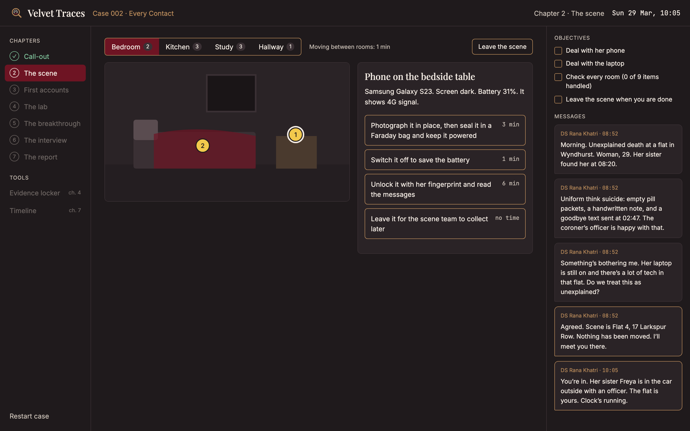
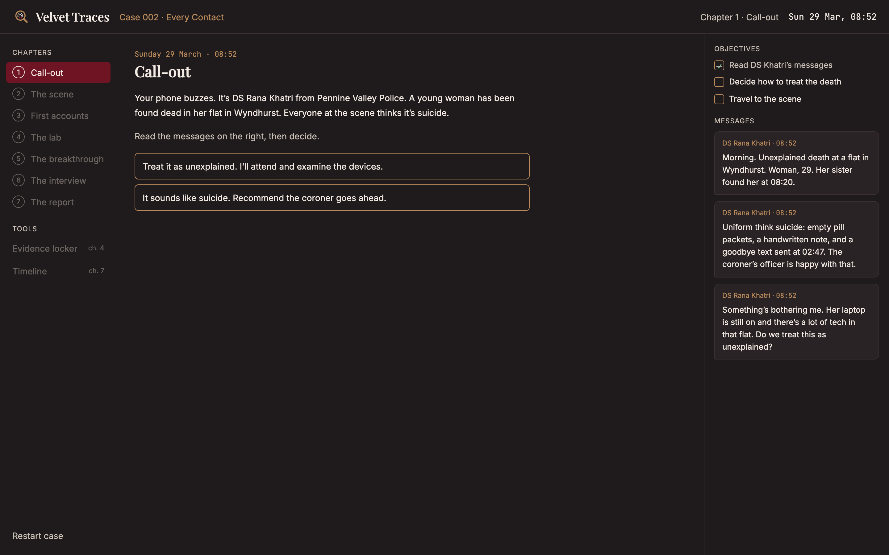
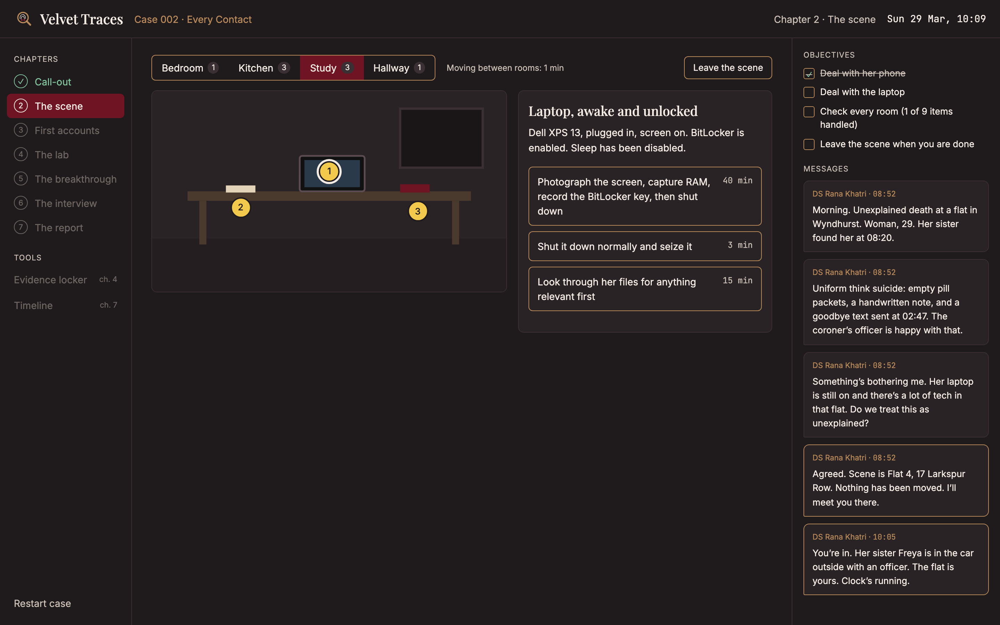
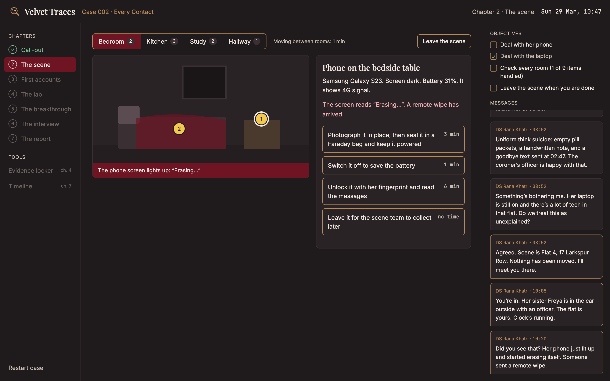
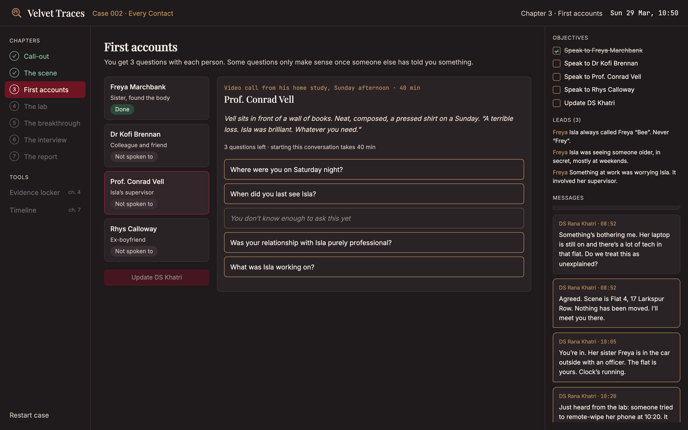
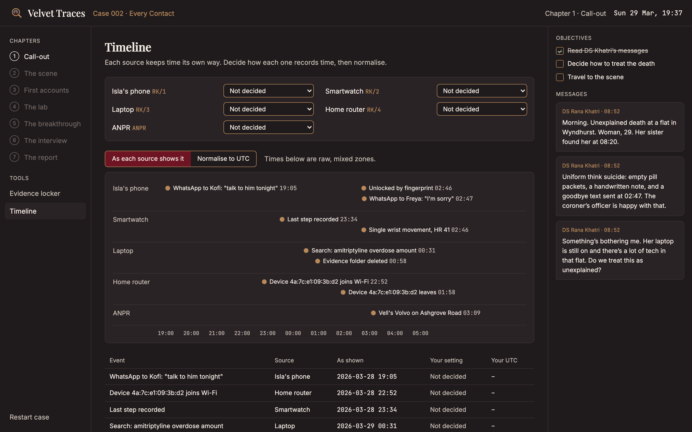
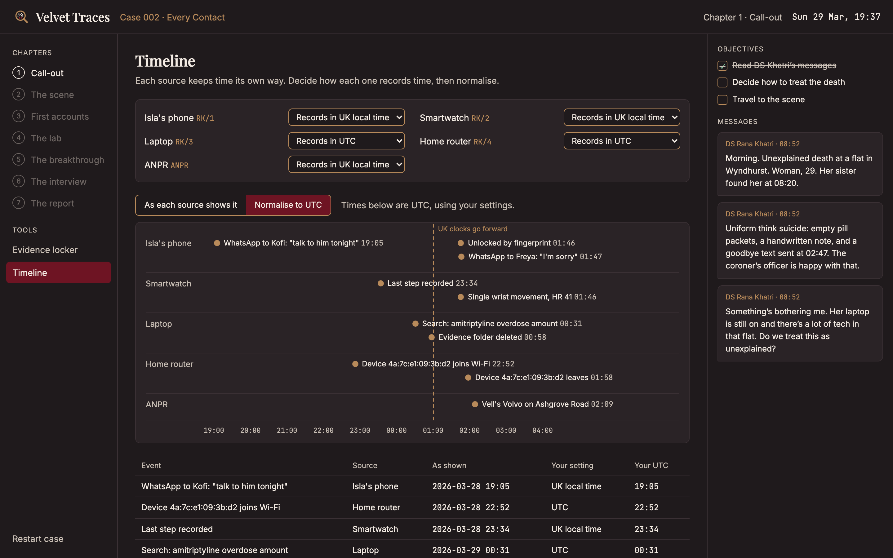

<div align="center">


# Velvet Traces

**A forensic investigation game built on real UK procedure.**
Preserve the evidence, question the witnesses, read the artefacts, and prove what happened.

*Every contact leaves a trace.*

</div>

---



## About

Velvet Traces is a single-player, browser-based detective game for forensics students and people starting out in the field. It plays like a case, not a quiz: you arrive at a scene, make the calls a real examiner would make, and live with the consequences.

The focus is **digital forensics** and **questioned document examination**, set in England and Wales. The game follows real practice: the ACPO principles for digital evidence, the Forensic Science Regulator's Code of Practice, chain of custody, live acquisition, and careful evaluative wording in the final report.

The game never highlights the right answer. Some mistakes show straight away: a phone left online gets wiped remotely. Others only surface at the debrief: a notepad sent for fingerprints before ESDA loses its indented writing for good.

## Case 002: *Every Contact*

> A 29-year-old researcher is found dead in her flat in Wyndhurst. Empty pill packets, a handwritten note, and a goodbye text sent at 02:47. Everyone at the scene thinks it's suicide. Her laptop is still on.

The case runs over seven chapters:

| # | Chapter | What you do | Status |
|---|---|---|---|
| 1 | Call-out | Decide whether the death is unexplained | ✅ Playable |
| 2 | The scene | Search four rooms against the clock and choose how to handle each item | ✅ Playable |
| 3 | First accounts | Question four people, with three questions each. Leads unlock new questions | ✅ Playable |
| 4 | The lab | Extract the phone, image the laptop, spend a limited lab budget | 🛠 In progress |
| 5 | The breakthrough | Make the case for a warrant | Planned |
| 6 | The interview | Choose what to disclose before a suspect interview | Planned |
| 7 | The report | Build a UTC timeline and write findings at the right strength | 🧩 Timeline built |

## Screenshots

| | |
|---|---|
|  |  |
| **Call-out.** The briefing arrives as messages from the detective sergeant. | **The scene.** Every action costs in-game minutes, and the clock is running. |
|  |  |
| **Consequences.** Spend too long on the laptop and the phone erases itself. | **First accounts.** Three questions each. Some only unlock once someone else has talked. |

<details>
<summary><strong>Spoilers: the timeline board</strong></summary>

<br />

Each source keeps time differently, and the case falls on the night the UK clocks go forward. Read as each device shows it, the order of events looks harmless:



Set each source's time zone correctly and normalise to UTC, and the story changes:



</details>

## What makes it realistic

- **Volatile evidence first.** Isolate phones in a Faraday bag, capture RAM before shutdown, and export router logs before pulling the power.
- **Real artefacts.** WhatsApp `msgstore.db` rows, Chrome history, `$UsnJrnl` deletions, Volume Shadow Copies, `WifiConfigStore.xml`, randomised MAC addresses.
- **Time zones are part of the puzzle.** Devices record in UTC or local time, and the case night includes the BST changeover.
- **Order of examinations.** ESDA must come before chemical fingerprint treatment.
- **Evaluative reporting.** Conclusions are scored on wording strength and stated limitations, not just on naming a suspect.

> The forensic content is written from published guidance and practitioner knowledge. It is being reviewed for accuracy, and corrections from people working in the field are welcome. Please open an issue.

## Getting started

Requires Node.js 20 or later.

```bash
git clone https://github.com/Ammu-yuu/VelvetTraces.git
cd VelvetTraces
npm install
npm run dev
```

Then open the URL Vite prints (usually `http://localhost:5173`). The game is designed for desktop screens, at least 1280 px wide.

Progress is saved in your browser. Use **Restart case** in the sidebar to start again. Add `?dev` to the URL to unlock every chapter and tool while developing.

| Command | What it does |
|---|---|
| `npm run dev` | Start the dev server with hot reload |
| `npm run build` | Type-check and build for production into `dist/` |
| `npm run preview` | Serve the production build locally |
| `npm run lint` | Run ESLint |

## Project structure

```
src/
├── game/
│   ├── story.ts         # Chapters, DS Khatri's messages, key story times
│   ├── scene.ts         # Rooms, scene items, handling choices and their grades
│   ├── interviews.ts    # People, questions, and the leads they unlock
│   ├── case002.ts       # Exhibits, sources, and timeline events
│   ├── time.ts          # UTC and UK local time conversion (BST rules)
│   ├── objectives.ts    # Objectives shown for each chapter
│   └── useGame.ts       # Game state, the in-game clock, saving
└── components/          # Screens: CallOut, Scene, Interviews, TimelineBoard, ...
```

Case content lives in plain TypeScript data files, so a new case is mostly writing, not code.

## Built with

React 19, TypeScript and Vite. No backend: everything runs in the browser.

## Disclaimer

All people, places, organisations, publications and events in this game are fictional. Any resemblance to real persons or cases is coincidental. The laws, forensic methods and device artefacts are real.

This game deals with a death presented as suicide. If you are affected by any of the themes, Samaritans are available 24 hours a day on **116 123** (UK and ROI).

## Author

Created by [Anya](https://github.com/Ammu-yuu).
